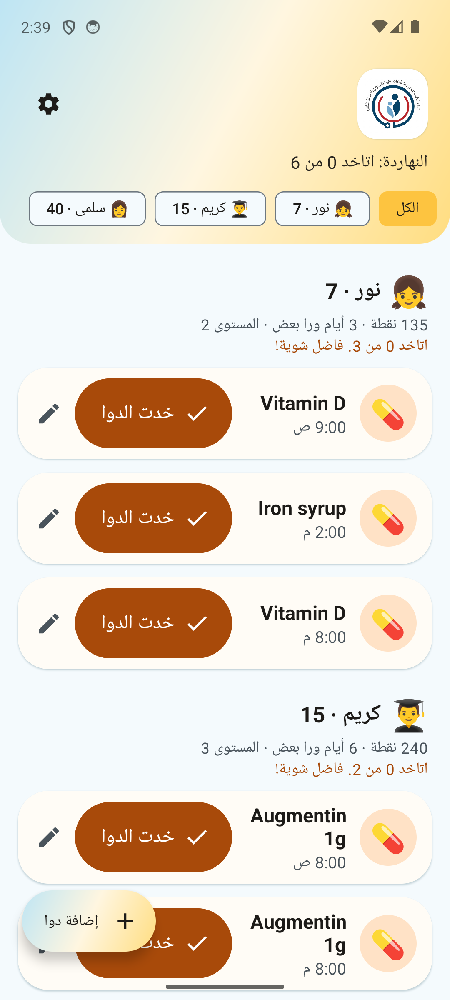
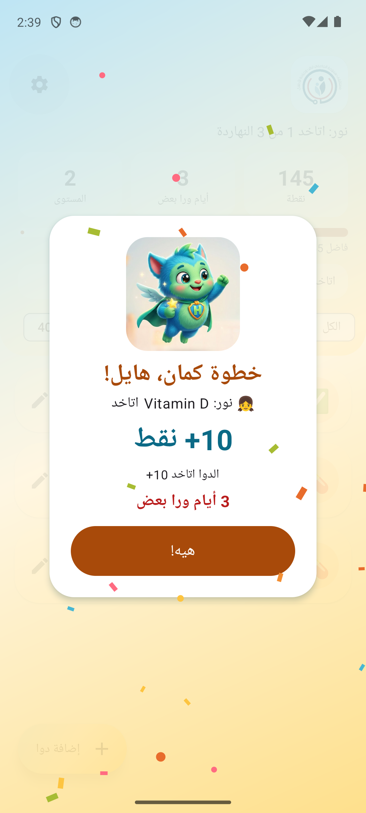
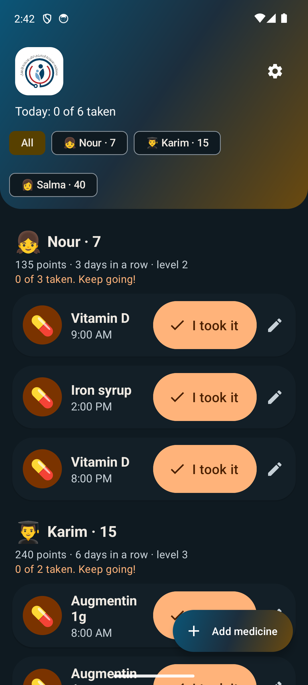

# Koko Dawa (كوكو دوا)

A medicine reminder for children, made for the patients of Smouha University Children's Hospital in Alexandria (ages 0 to 18) and their families. The app is called Koko Dawa (Arabic: كوكو دوا), after its rooster mascot Koko; until version 1.0.0 it was called Smouha Kids. This is an independent project: it is not an official product of the hospital, and the hospital has not approved or endorsed it.

**A reminder tool only.** The app gives no medical advice, suggests no doses and checks no medicines. A parent types the medicine and the times; the doctor's instructions always come first.

## بالعربي

«كوكو دوا» تطبيق أندرويد بيفكّر الأطفال وأهاليهم بمواعيد الدوا، بصوت المنبه حتى لو الموبايل صامت، وبيفرّح الطفل بنقط ومكافأة لما الدوا يتاخد ويتأكد بالرقم السري للأهل. كل البيانات بتفضل على الموبايل: مفيش إنترنت ولا حساب ولا نسخة احتياطية. التطبيق للتذكير بس، ومش بيدي نصايح طبية ولا جرعات، والتعليمات دايمًا من الدكتور. المشروع مستقل، ومش منتج رسمي من المستشفى ولا معتمد منه.

## What it does

- **Reminders** for each medicine: every day or chosen days, one or more times, optional start and end dates. Each reminder names the patient and the medicine.
- **The alarm sound** plays for up to 30 seconds at each reminder, also when the phone is on silent or vibrate, with a "Stop sound" button. If a dose is not confirmed: up to 3 follow-ups every 5, 10, 15 or 30 minutes.
- **Parent PIN** (4 to 8 digits, on its own keypad): confirms each dose (can be turned off) and protects adding, editing and deleting medicines.
- **Rewards:** +10 per dose, +5 on time (within 30 minutes), +20 when all of the day's doses are taken, +50 at 3, 7, 14, 30, 60 and 100 days in a row; a level every 100 points; points are never taken away. A missed day ends the streak with a gentle message.
- **Several patients on one phone**, each with their own points, streak and style by age group: child (0 to 12) and teen (13 to 18) see a celebration character with confetti and a short happy sound (parent setting "Celebration sound", PIN-protected), adult (19 and over) a calm checkmark.
- **End of a course:** when the last dose of a medicine with an end date is confirmed, a short video of a celebrating child says the recorded schedule is complete (never that the treatment is finished).
- **Egyptian Arabic and English**, right to left in Arabic; small phones, tablets, large fonts, light and dark mode.

## Screenshots

Version 1.1.0 (Koko Dawa), from the signed release on the test emulator with fictional demo data only (`scripts/seed-demo.ps1`): [docs/screenshots-v1.1/](docs/screenshots-v1.1/README.md) (25 shots: icon, onboarding, home, About, rewards, streak ended, end of a course, settings, the palette). The 72 older shots of 1.0.0 (Smouha Kids look, both languages, four screen sizes) stay in [docs/screenshots/](docs/screenshots/README.md) for the layouts.

| Home (Arabic) | Reward, child (Arabic) | End of a course (Arabic) | Home (English, dark) |
|---|---|---|---|
|  |  |  |  |

## Privacy and permissions

Everything (patients, medicines, doses, points) stays in a local database on the phone. The app has **no internet permission**, no account, no analytics and no ads; Android backup is off (`allowBackup=false`), so uninstalling deletes all data and nothing moves to a new phone. The parent PIN is stored only as a salted PBKDF2 hash.

| Permission | Why |
|---|---|
| `POST_NOTIFICATIONS` | Show the reminders (Android 13+ asks the parent). |
| `USE_EXACT_ALARM`, `SCHEDULE_EXACT_ALARM` (up to Android 12L) | Remind at the exact minute. |
| `RECEIVE_BOOT_COMPLETED` | Book the reminders again after a restart. |
| `VIBRATE` | Vibration with the reminder and on the PIN keys. |
| `FOREGROUND_SERVICE`, `FOREGROUND_SERVICE_SYSTEM_EXEMPTED` | Play the alarm sound for up to 30 seconds (docs/DECISIONS.md D28). |
| `DYNAMIC_RECEIVER_NOT_EXPORTED_PERMISSION` | Added by AndroidX for the app's internal messages; not visible to users. |

`scripts/verify-dist.ps1` checks every release file for this list (no `INTERNET`), for `allowBackup` false, for "not debuggable" and for the release certificate.

## For parents: installing and using

The app is shared as a file through Google Drive (no Play Store, Android 9 or newer, no iPhone). The Arabic guides walk through every screen: `2_طريقة_التثبيت.pdf` (install) and `3_طريقة_الاستخدام.pdf` (use), in the parents' Drive folder (`dist/DRIVE.md`). In short:

1. Open the Drive link on the phone and download the app file. Chrome may warn that the file can harm the device: "Download anyway".
2. Open the file. Android asks to allow installing from this source: Settings, turn on "Allow from this source", go back, "Install". Google Play Protect may warn because the app is not from Google Play: "More details", then "Install anyway". On Samsung, Auto Blocker can block it: turn it off in Settings > Security and privacy, install, turn it on again.
3. Open the app: choose the language, create the parent PIN (keep it away from the children), add the first medicine (who it is for, name, times), then allow notifications. Without them no reminder can appear.
4. Exact reminders are automatic on Android 13+; on Android 12, if home says reminders may be late, tap Fix and allow "Alarms and reminders".
5. Battery: some phones stop apps in the background. Parent settings > Battery settings: set Koko Dawa to "Unrestricted". On Samsung keep it out of "Sleeping apps" (add it to "Never sleeping apps"); on Xiaomi also allow Autostart.
6. Parent settings > "Send a test reminder", close the app: a reminder arrives in about 10 seconds, with the alarm sound.

**Updating:** install the newer file over the old one; everything is kept. Do not uninstall first: uninstalling deletes all data. **Forgot the PIN:** "Forgot PIN" works after unlocking with the phone's own screen lock and keeps all data. **Force stop** cancels reminders until the app is opened again.

## For developers

Android, Kotlin, minSdk 28, targetSdk 37, Room (schema in `app/schemas`), Material 3, no network. The contract and rules are in [app/claude.md](app/claude.md); progress, decisions and the report in [docs/PROGRESS.md](docs/PROGRESS.md), [docs/DECISIONS.md](docs/DECISIONS.md), [docs/FINAL_REPORT.md](docs/FINAL_REPORT.md), the history of the contract in [docs/CHANGELOG.md](docs/CHANGELOG.md).

Build and test (JDK from Android Studio; Windows):

```powershell
$env:JAVA_HOME = "C:\Program Files\Android\Android Studio\jbr"
.\gradlew.bat testDebugUnitTest lintDebug assembleDebug
# Instrumented tests run ONLY on the test emulator Pixel_API_34_test (never on a phone or on the
# manual emulator Pixel_API_34). Start it with: emulator -avd Pixel_API_34_test -port 5560
$env:ANDROID_SERIAL = "emulator-5560"
scripts\run-tests.cmd connectedDebugAndroidTest
```

`scripts/run-tests.cmd` refuses any other device and leaves the app installed after the run; running `connected*` or `uninstall*` tasks directly with `gradlew` fails on purpose. The full suite with a report: `docs/evidence/tools/suite.ps1`.

Release and sharing ([docs/RELEASE.md](docs/RELEASE.md)): `scripts/build-release.ps1` (signed with the release key from `keystore.properties`, never committed), `scripts/verify-dist.ps1`, `scripts/update-test.ps1` (a newer version over the old one keeps every row), `scripts/build-dist.ps1` (the Drive folders in `dist/`), `scripts/make-docs.ps1` and `scripts/make-card.ps1` (the Arabic PDFs and the printable card, `docs/print/`). Real phone checks: [docs/PILOT.md](docs/PILOT.md). The repository and its pull-request flow: [docs/GITHUB.md](docs/GITHUB.md). Arabic review sheet for a native speaker: [docs/ar-review.md](docs/ar-review.md) (`scripts/ar-review.ps1`).

The pill-tracker idea comes from the earlier project Medipulse-App; this is a separate, rewritten app.

## License

All rights reserved. No license has been chosen yet; that is an open decision (the doctor or the hospital first has to agree to any publication). Until then the repository stays private.
